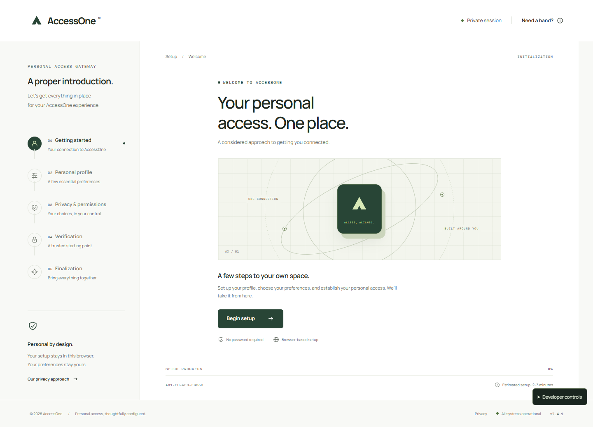

# AccessOne

A premium personal access gateway with 24 major stages, 36 personality questions, two CAPTCHAs, two extremely unnecessary verification codes, one deceptive progress bar, and no useful outcome.

The final screen reads **bro you really did all that 💀**.

Live site: **https://guardianec.github.io/accessone/**. Source: **https://github.com/Guardianec/accessone** (public so GitHub Pages can host it for free). Pushes to `main` run checks, build the static app, and deploy through `.github/workflows/deploy.yml`. No deployment secrets are required; GitHub issues a temporary deployment token.



## Run locally

Use Node 22.13+ (or a current supported Node LTS) and npm. From PowerShell:

```powershell
cd C:\Users\User\Documents\ChatGPT\Websites\accessone
npm install
npm run dev
```

Open **http://127.0.0.1:5174/**. The development server binds to loopback. To access it on your LAN, explicitly change the host in the dev command; production should serve the static build over HTTPS.

```sh
npm run build
npm run start
```

`start` previews the production build at the same URL. Stop the dev server before using it. Vite preview is a local inspection server; use static hosting or Nginx for production.

## Experience

Landing → setup overview → 18 theatrical providers → basic profile → regional preferences → terms → privacy → cookies → two CAPTCHAs → two displayed verification codes → device compatibility → three calibration samples → humanity tasks → personality assessment → false 100% completion → newly discovered requirement → recovery preferences → interface calibration → final review → verify verification → final confirmation → 30-second processing → reveal, statistics, achievements, and a reward of Nothing.

Normal participation targets 8–15 minutes. Reading speed affects this considerably; there are no artificial question timers. This estimate needs a human timing study. The intentionally inaccurate landing estimate is part of the prank.

## Architecture and structure

Static React + TypeScript + Vite. CSS handles animation; no motion library, database, server routes, authentication SDK, analytics, or remote assets are needed. Fonts are bundled locally.

```text
src/
  config/prank.ts   Copy, stages, questions, providers, timing, achievements
  App.tsx          Application shell, interactive stages, reveal, debug panel
  ui.tsx           Accessible controls, SVG icons, dialogs, timed status sequence
  state.ts         Session schema validation, progress, counters, achievements
  styles.css       Design tokens and responsive interface
tests/
  state.test.ts    State and privacy invariants
  flow.spec.ts     Full browser flow, network observation, responsive sweep
docs/
  DESIGN.md        Design direction and pacing
  DEPLOY_DEBIAN.md Debian/AWS, Nginx, HTTPS, updates
.openai/hosting.json  Site identity and static output configuration
```

## Local state and privacy

Answers (including nicknames) live only in React memory. They clear on refresh, tab closure, or reset. This deliberately avoids storing questionnaire answers, even temporarily on disk. All questions are harmless choices; never enter sensitive information.

`sessionStorage['accessone.session.v1']` stores only a random session label, timestamps, stage/index, completed stages, click count, attempted provider names, CAPTCHA count, answered question **IDs**, progress reversals, and achievements. It contains no answer values. A refresh resumes the current stage; incomplete tasks within a stage restart. Personality resumes at the last question, which must be answered again because the answer was not persisted. A blocked session-storage API gracefully falls back to in-memory progress. No `localStorage` is used.

The session ID uses an ordinary random label; it is decorative, not a security token. Capability animations are interface checks, not real hardware profiling. There is no browser fingerprinting, camera/microphone/location access, OAuth, email, SMS, credential input, form submission, or network client. Provider buttons never connect to external accounts. Consent categories only change UI memory; “Reject unnecessary cookies” works and no tracking exists in any configuration.

Static hosting necessarily receives asset requests, and hosting services may keep infrastructure logs. No questionnaire or form contents are included in those requests. Keep host-injected analytics disabled.

## Reset and debug mode

Normal mode: Cancel setup → Escape while you still can, or click Privacy → Reset local prank data. On the reveal, use Restart this terrible experience.

Append **`?debug=1`** to reveal developer controls in the lower right. This is a local interface panel with no remote operations. It can jump to any stage, reset, preview the reveal, inspect the safe session state, toggle fast animations, or constrain the app to mobile width.

Examples:

- `http://127.0.0.1:5174/?debug=1&stage=providers`
- `http://127.0.0.1:5174/?debug=1&stage=personality`
- `http://127.0.0.1:5174/?debug=1&stage=processing&fast=1`
- `http://127.0.0.1:5174/?debug=1&stage=reveal`

`stage` uses the ID in `stages` and is honored only with `debug=1`. Fast mode shortens timed sequences to 450ms and calibration waits to 100ms. Debug previews show actual counters, so skipping to reveal will naturally have incomplete statistics and achievements. Mobile preview is convenient; real viewport QA is covered by Playwright. Do not share a debug URL; Copy prank link removes all parameters.

## How to customize the prank

Edit **`src/config/prank.ts`**, then rebuild:

| Change                     | Configuration                                                |
| -------------------------- | ------------------------------------------------------------ |
| Friend’s nickname          | `prank.friendNickname` (blank by default; appears on reveal) |
| Final reveal               | `prank.finalMessage`                                         |
| Personality questions      | `personalityQuestions`                                       |
| Questionnaire length       | `prank.personalityLength` (clamped to available questions)   |
| Loading messages           | `prank.loadingMessages`                                      |
| Provider buttons           | `prank.providers`                                            |
| Provider explanations      | `prank.providerReasons`                                      |
| Achievement names and copy | `prank.achievements` (retain IDs used by state transitions)  |
| Timings                    | `prank.timing` (milliseconds)                                |
| Stage headings             | `stages`                                                     |
| Colors, type, radii        | Tokens at the top of `src/styles.css`                        |

Amount of bureaucracy: start with questionnaire length and timing. To add/remove a **major stage**, update `stages`, the `Stage` renderer and rail ranges in `App.tsx`, progress/achievement boundaries in `state.ts`, and the complete-flow tests together. Major-stage dependencies are intentionally explicit; they are not a generic workflow engine.

State schema version is `1`; bump the storage key and version if structural changes make existing sessions incompatible. Update the tests when changing question length, codes, required inputs, or stage sequence.

## Checks

```sh
npm run format
npm run lint
npm run typecheck
npm test
npm run build
npm run test:e2e
```

Playwright uses installed Chrome on Windows and bundled Chromium elsewhere. On Linux, if needed, install the browser with `npx playwright install chromium` and the documented OS dependencies. The tests start Vite unless it is already running at port 5174. Browser tests walk the complete flow in fast mode, verify fake provider behavior, inspect session storage, observe network traffic, test refresh/reset/cancel, and check each major stage at 1440px, 768px, and 390px. Screenshots are written into `docs/`.

## Static public deployment

Build command: **`npm run build`**. Publish directory: **`dist`**. No runtime variables or secrets. Use the `accessone` directory as project root if connecting the parent repository. Node 22.13+ is recommended.

- **Netlify:** import the repository, set the build command and publish directory above; or upload the built `dist` directory. See [Netlify’s Vite guide](https://docs.netlify.com/build/frameworks/framework-setup-guides/vite/).
- **Cloudflare Pages / Vercel:** import the project as Vite, use the same build/output settings, disable optional analytics, and publish.
- **GitHub Pages:** publish `dist` via GitHub Actions. Assets use relative paths, so repository subpaths work. Follow [Vite’s static deployment guide](https://vite.dev/guide/static-deploy.html).
- **Sites:** the tracked `.openai/hosting.json` contains the private Site identity. The owner can publish through the Sites workflow and choose an audience separately. Do not treat a private preview as a link your friend can access.

Only serve `dist`; never publish the full source directory as a static root. The generated app has no server API, so there is no backend to configure.

## Debian / AWS deployment

Follow [docs/DEPLOY_DEBIAN.md](docs/DEPLOY_DEBIAN.md) for a basic Debian VPS or AWS EC2 Debian instance: upload the build, configure Nginx, allow ports 80/443, point DNS, and obtain HTTPS with Certbot. No Node process or database is necessary on the server.

## Design skills

Used: **frontend-design**, **ui-ux-pro-max**, **design-system**, **ponytail**, and **Sites**. Their applied decisions are documented in [docs/DESIGN.md](docs/DESIGN.md). Browser QA uses Playwright. The polished interface is intentional; the progressively unnecessary work is the joke.
